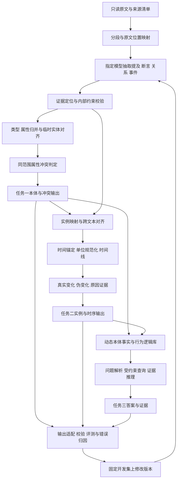

# D01 完整实施计划与算法实现逻辑

版本：计划V1；日期：2026-10-27，北京时间。项目：`D:\Source\ZGDK\D01`。远端：<https://github.com/elton-coding/ZGDK-D01.git>。

本文件是可以据以实施和验收的设计，不是已经运行的系统。当前只完成仓库初始化、原题核对、资源诊断与方案设计；正式数据、指定模型、官方schema与评分程序尚未取得。先把可复现基线走通，再按留出结果改进，最后形成完整参赛成果。

## 1. 目标、范围与关键决策

目标是构建一套基于指定国内开源千问27B、以Python为主要开发语言的本体标注和增强推理系统，完整覆盖三项任务。初赛优先交付任务一、任务二的可靠结果与可复现程序；提前为任务三保留事实、时间和证据接口。

采用两项明确设计选择：

1. **同一套证据事实表示贯通三项任务。** 类型、实例、属性断言、关系、时间与来源分层记录，按官方格式导出，避免各阶段分别生成互相矛盾的JSON。
2. **一个指定底座分步处理，确定性程序承担结构和精确计算。** 模型负责语义抽取、属性身份与关系判断、必要的原因和问题理解；程序负责证据定位、单位换算、约束检查、可执行查询和导出。初期不叠加多个模型、不全参数训练、不先上复杂图数据库。

任务一和任务二分别采用同一“证据约束抽取与归并”模型体系在类型层和实例层的投影；任务三采用“本体约束检索推理”体系。基线和消融不增加新的独立模型家族。

不设没有依据的目标分数或获奖概率。优先目标是：覆盖要求、输出合法、语义有据、评价诚实、运行可复现；改进是否有效由固定留出实验和官方反馈决定。

## 2. 官方任务与验收口径

以下页码来自本地19页D01赛题PDF，不代表已经核验全部后续公告。

| 官方任务 | 输入 | 要交付的结果 | 已知评价与关键约束 |
|---|---|---|---|
| 任务一：本体融合建模与属性冲突检测 | 多来源文本，含来源id | 本体对象类型、属性、关系与冲突的JSON，程序和技术方案 | 初赛50分；对象类型/属性融合拆分/冲突/关系；类型名称须取自原文，第2—3、8—10、17—18页 |
| 任务二：实例化映射与时序状态演化 | 文本及任务一本体 | 实例与关系、时序值、伪变化、变化原因等结果，程序和技术方案 | 初赛50分；实例、时间四元组、状态变化等；原因挖掘是明确要求，未公布独立权重，第3—4、12—18页 |
| 任务三：动态本体增强推理 | 任务一二结果、行为逻辑建模信息、专家问题清单 | 问题答案、程序/镜像/部署说明和技术方案 | 样例初赛后提供；要求逻辑有效、答案准确与可复现；复赛具体评分待公布，第4—6、19页 |

全局约束：指定千问27B、Python为主要语言、作品原创和可复现，不得抄袭/搬运/篡改第三方成果，不得使用竞赛外私有涉密数据、商用授权数据（第5页）。正式模型版本及第三方库/公开数据使用边界需按后续规则核实，不把“引用论文思想”解释成可直接搬用成套参赛方案。

初赛满分100：任务一综合F1×50＋任务二综合F1×50。各任务内部子项权重、文本语义匹配阈值、编码置换与重复项处理未完整公布，不能自行当作已知。任务二的原因不能因评分表未单列就删除。

## 3. 已查环境与先决条件

本轮实际诊断：

| 项目 | 结果 | 对实施的含义 |
|---|---|---|
| GPU | NVIDIA GeForce RTX 5090 D，32607MiB，驱动591.86 | 有约32GB可见显存；模型容量与长上下文必须实测 |
| CPU/内存 | 24逻辑CPU；物理内存136859803648字节，约127.5GiB | 可用于文本处理、索引、缓存与必要CPU卸载，吞吐尚未测试 |
| 当前Python | Anaconda Python3.13.5 | 不据此锁定正式环境，项目建立独立环境 |
| 当前PyTorch | 2.7.1+cu118，发出sm_120架构不在支持列表的警告 | 8×8 GPU乘法实测返回8.0，但这不能证明完整模型/量化算子兼容；必须更换或验证合适构建 |
| 推理依赖 | transformers尚未安装 | 本轮不安装或改动全局环境 |
| Linux环境 | WSL列举返回未安装提示 | Linux容器复现环境尚未准备，不假定Docker/WSL已经可用 |
| 题目/数据 | 有19页PDF；没有官方验证集、模型确切版本与评分程序 | 可完成设计及合成边界测试；不能报告比赛性能 |

官方PyTorch资料说明Blackwell支持与CUDA12.8构建相关；实际选用的Python、PyTorch、CUDA、推理引擎版本应在指定模型确定后联合验证并锁定，不盲目安装最新版本。[PyTorch发布说明](https://pytorch.org/blog/pytorch-2-7/)

27B参数按4bit仅权重理论下限约13.5GB（十进制），不含量化元数据、未量化层、KV缓存、激活、框架和工作区；16bit仅权重约54GB。这个算术估计只说明量化值得测试，不证明任何实际格式能在本卡运行。量化是否允许、哪种格式兼容指定模型均待确认。

G0候选顺序：隔离环境＋兼容内核 → 指定模型单条短文本 → 量化精度对比/真实资源测量 → 上下文与并发预算 → 最终部署栈。开发机可使用本地推理服务作为接口；评测需要离线时，服务与权重也随容器在本地运行，不能依赖开发助手或外部服务生成正式答案。

## 4. 数据合同与统一内部表示

### 4.1 原始输入审计

领取数据后先检查：文件数量/格式/编码/hash、记录id唯一性、来源组织方式、文本长度与上下文窗口、字段缺失、标注覆盖、实体/事件/时间分布、冲突与伪变化占比、跨文档重复、来源和实体之间的连接关系。

原始文本不可改写覆盖。清洗只生成派生视图并保留字符位置映射；全半角、空白、日期与单位处理要能回溯原文。source_id只作来源标识，不利用其前缀、编号规律或可能的标签暗示推断答案。

### 4.2 统一表示（设计字段，不是官方新增字段）

| 内部对象 | 关键内容 | 用途 |
|---|---|---|
| Document | source_id、原文、hash、文档位置 | 追溯与去重 |
| Mention | 原文片段、起止位置、候选类型 | 将提及与对象类别、实例分开 |
| Entity | 稳定内部id、类型、强标识、提及、禁止合并约束 | 同一对象跨文档归并 |
| AttributeDefinition | 所属类型、含义、口径/分母/角色、量纲、时间语义、别名及证据 | 属性同义归并与异义拆分 |
| Assertion | 主体、属性、原始值、规范值、单位、事实时间、记录时间、粒度、限定条件、证据 | 冲突、状态及时间计算 |
| RelationAssertion | 源/目标实体、关系、角色、有效时间、证据 | 关系映射与查询 |
| Event/Change | 触发事件、前后断言、变化类别、因果证据 | 真实/伪变化与原因 |
| Decision | 阶段、候选、判断、证据、规则/模型版本、待判状态 | 复盘，不直接混入比赛输出 |

初版建议JSONL存过程、SQLite存实体/断言/关系及索引；不要求使用RDF或重型图数据库。来源表示借鉴PROV思想，时间粒度借鉴时间本体的区分，字段和代码自行实现；这些标准不是比赛强制格式。[PROV-O](https://www.w3.org/TR/prov-o/)，[Time Ontology](https://www.w3.org/TR/owl-time/)

原始值与规范值双存：例如原文`1000mg`用于导出/证据，规范值`1g`用于判断，不能换算后丢掉原文。每个模型给出的证据片段必须能在相应source_id中定位；找不到则重定位或拒绝该断言，不能静默接受幻觉引文。

### 4.3 本体层与实例层必须分开

对象类型是“医生”“患者”等原文类别；“张伟”“戴昕”等是实例。任务一虽只输出类型层，也必须内部先建立最小临时实例范围，防止把不同患者的不同性别、不同医嘱的不同剂量当成类型属性冲突。

内部id不等于业务主键。缺少真实标识时可以内部生成稳定id；不能伪造身份证号、就诊号或外键。合成id是否能作为官方输出主键需按正式规范适配。

## 5. 总体算法与数据流



模型调用采用小任务提示模板：字段定义、输入文档、允许的schema、必须返回证据、无法判断的表示。结构化解码用于降低JSON格式错误，但不视为语义正确性保证；候选推理引擎支持情况要验证。[vLLM结构化输出文档](https://docs.vllm.ai/en/latest/features/structured_outputs/)

初始按来源/关联实体分组处理，不把全库一次塞入上下文。长文本分段保留标题和局部时间上下文，重复窗口只作为候选召回，最终依证据位置去重。全局归并采用分层汇总与候选检索；候选阻断只提速，需在开发集测漏召回，不允许把未召回默认当作不相同。

缓存键包含输入hash、模型版本、提示版本、schema、采样/推理参数；改变任何项均重建对应缓存。结果输出排序和编码确定，超时/无效JSON有限次重试后显式失败，不输出伪造的空结果充当成功。

## 6. 任务一：本体融合与冲突检测

### 6.1 类型与候选事实抽取

对每个分段提取对象提及、原文类别词、属性值、关系、事件、时间、否定/计划等限定条件。候选类型必须给原文类别词证据；同义类型是否归并由文本含义和验证集口径决定，最终采用有原文出处的规范名称。不额外发明题目没有要求的`is_a`层级。

先做局部抽取再做跨源归并，避免分段阶段过早裁决并丢失少数来源。第一条模型调用即可提供直接结构化输出基线，完整方法另保留所有可追溯中间记录，比较增益与额外耗时。

### 6.2 属性身份判断：先判断是不是同一属性

属性语义签名定义为：所属类型、对象/角色、属性含义、测量/统计口径、分母/范围、量纲、时间语义。名称相同只是候选依据，不能直接合并。

流程：候选召回 → 对照原文和签名判断同义/不同口径/待判 → 受约束归并 → 整簇一致性复核 → 保留别名和拆分理由。

不能把任意相似边直接取连通分量：A与B近似、B与C近似不保证A与C同义。每次合并后检查所属类型、量纲、角色与口径，违反则撤销或待判。初期候选索引用可解释的词项和签名，向量检索只有在指定模型/额外组件许可明确且确有召回收益时再增加。

| 自拟边界例子 | 应有逻辑 |
|---|---|
| 频次“每日两次”与“给药频率一天两回” | 可归同一属性，值等价 |
| 单次剂量100mg与日总剂量100mg | 分母/口径不同，拆成两个属性 |
| 规格50μg/片与每次使用50μg | 产品规格与用药量不同，不合并 |
| 相同姓名、不同可靠业务标识的两人 | 不因名字一样强行合为一人 |

以上是设计用合成例子，非比赛数据与成绩。

### 6.3 冲突判断：限定同一对象与可比条件

对每一组断言先确认同一主体、同一语义属性、同一业务范围和可比较时间，再区分等价、兼容、互斥和不可比。不同对象的不同值不冲突；不同时刻明确调整通常是变化；计划和已发生事实不能直接比较；多值属性的两个值也未必互斥。具体时间/范围判分口径仍需官方样本确认。

内部属性身份状态：直接同一、需语义推理、不同、未决；值关系状态：等价、互斥、兼容、不可比。两种状态分开，不能把低置信度一律报成冲突。

官方两档必须忠实执行：

1. 能直接确认同一属性并构成冲突：属性正常创建，输出冲突及各来源。
2. 需要先判“是否同一条属性”的冲突档：按原题暂不创建该属性，仍输出冲突。其准确标签触发条件及未创建属性的`property`编码未明，G0用官方标注和说明固定，不自行推广成“有疑问都不创建且报冲突”。

每条冲突保留来源集合及原文claim，输出`attribute_status`、属性引用和claims。未创建属性的内部候选id独立保存，最终编码通过适配器，不能制造指向不存在正式属性的普通外键。

### 6.4 关系与本体导出

只提取有文本语义支持的关系，不对同段所有对象两两连边。关系方向、主/外键、基数与实际实例证据一起核验；复杂多元关系先保留角色结构，再按官方schema投影，不能擅自新增对象类型来“解决格式问题”。

输出适配器生成`model.object_types`、`model.link_types`与`conflicts`；检查类型/属性编码唯一性、主外键存在性、关系端点、属性类型、类别名证据和冲突引用。允许业务上的冲突，不以“消除矛盾”为由覆盖原始claim。

## 7. 任务二：实例、时间、变化与原因

### 7.1 实例映射与消歧

使用任务一产出的本体，将提及映射到类型，再按可靠标识进行候选实体归并。先使用强标识；无强标识时组合姓名、上下文关系、相关事件与时间证据，并保留不能合并的约束。相同强标识仍需检查标识类别/签发范围，互斥强标识不合并。

药品产品、就诊、医嘱和医嘱用药记录不是同一粒度。不能只按药品名合并多人的用药记录。实例和关系通过一致映射导出，临时id不代替虚构业务标识。遇到不确定实例先保持分开并记录待判，再用开发数据决定精确率/召回率权衡。

端到端测试必须使用本系统预测的任务一本体；另做参考本体输入的诊断实验只用于分离上游与实例模块误差，不能把后者成绩冒充端到端结果。

### 7.2 事实时间锚定

每条断言分别记录事实有效时间与记录/报道时间。优先使用断言内显式时间；相对时间结合有明确语义联系的事件锚定；不能把全文第一个日期传播给所有事实，不能用程序运行日补空值。

内部时间表示包含原文、规范值、精度、最早/最晚界、时区（若有）及锚定证据。粗粒度年/月可以用内部半开区间辅助比较，但输出保留原文所支持粒度，不能擅补为1月1日/月初或虚构秒。

例如：“11月21日入院，次日停药”可将停药锚定22日；“11月报道上月停药”只能确定相应月粒度；“2025年”与“2025-06-01”区间重叠，不能仅按字符串排序断言先后。

PDF第14页模板写日期格式，第18页评分要求按可确定最细粒度；内部先支持年/月/日/时分秒和未知，实际输出由正式schema决定。

### 7.3 单位与状态等价

使用精确十进制或有理数、单位与量纲核验处理数值等价。`1000mg=1g`可换算；“一片=100mg”必须有对应药品规格和剂型证据。原文单位和值同时保留，不能把不确定映射强制数值化。

语义状态等价由属性语境约束：“未记录发热”不等于“无发热”，“疼痛减轻”不等于“无疼痛”。通用同义归并不可覆盖否定、程度、计划、条件等限定。

### 7.4 时间线与真实/伪变化

时间线键至少包含主体、变化属性、关联对象/关系角色、必要业务上下文。患者同时服用两药时分别比较；同药并行医嘱或不同途径不能仅用药名混合。官方`relatedItem/relatedItemVal`用于输出关联范围，内部更完整的上下文不可丢弃。

对同键观察，只对同一次事实观察的重复抽取合并证据：主体、属性、上下文、事实时间及其粒度、原始状态和观察身份/证据来源必须一致，或有证据确认是同一观察的转述。重复窗口抽到同一原文是典型可去重情况。不同时间即使状态及写法都相同也必须保留各时点；同一粗粒度时间内不能证明是同一观察的记录也不擅合并。再依据能确定的时间顺序比较相邻观察：

```text
同一观察被重复抽取              → 合并重复抽取证据
不同时点语义值及表达都相同      → 保留各时点，标记持续同状态
原文不同、规范语义和值相同      → 伪变化，保留前后来源与原文
值不同、时间明确先后、范围相同  → 实际变化候选
同一时点同一条件、取值互斥      → 冲突候选
时间并列/区间重叠/单位不明      → 不可直接排序或比较，保留待判
```

伪变化不能被全局去重抹掉，`statusPairs`要保留前后时间、来源和值。`values`是否包含伪变化端点、是否只列变化和基线，必须由正式标注契约确定，不能只凭残缺样例猜测。

合成边界例：t1为100mg、t2仍为100mg、t3为0.1g，且时间明确递增。保留t1、t2、t3；t1→t2为持续同状态，t2→t3为表达变化但数值等价的伪变化，不能因合并t1/t2而把伪变化端点错报成t1→t3。

### 7.5 跨文本变化原因

在相关实体、关联对象与时间范围内检索候选触发事件；核验事件是否有明确因果表达或可以连成有据解释。内部区分明确因果、证据支持的推断和仅时间相关。不能用领域常识替本批文本编理由，也不能把“先发生”直接当作“导致”。

输出简短、可追溯理由；没有充分依据按原题允许空字符串。跨文档多来源引证如何映射到`reason`字段，待官方schema确认；内部完整证据仍保留。

## 8. 任务三：本体增强推理与问答

任务三不等到复赛才从零设计，但在样例未知时不提前扩展成通用智能体平台。

候选流程：问题 → 类型/实体/时间/关系/操作解析 → 基于本体的结构化查询计划 → 只读执行与证据收集 → 必要的受约束推理 → 答案和依据 → 事实及矛盾复核。

行为逻辑表示为可版本化的状态、事件、前置条件、状态变更与时间约束。只使用题目提供或输入文本支持的规则，不为每个领域硬编码答案表。规则注明来源、适用范围，数据缺少条件时返回未知，不使用“没有查到”直接证明否定。

初版查询计划使用白名单操作：实体过滤、属性读取、关系连接、时间过滤、计数/比较、前后状态、来源追溯。由程序转为参数化SQL/受约束图遍历，不直接执行模型生成的任意Python或任意SQL。

多跳推理保留每一步的事实与规则来源；遇到冲突列示分歧或按官方回答要求表达不确定，不强行选一个值。答案生成只使用查到的证据与已验证计算结果，最终核验关键实体、时间、数值和单位。

用三组对照归因：直接文本问答基线、使用预测本体的端到端推理、使用参考本体的诊断上界。任务三评分和样例到位后确定正式匹配与接受标准，当前只做流程与边界验收，不编造问答准确率。

## 9. 评测：先建立可信反馈，再优化

### 9.1 数据划分与泄漏控制

以主要业务主体/个案/事件链及其强相关来源组为单位划分开发与留出；近重复文本和同一事件改写必须同组。医生、科室等高频共享实体不能把整张关系图连成一个巨大分组；先辨别其共享背景角色，记录跨组交集，并禁止利用其留出标签。若任务的评测单位确需所有实体互斥，则另设更严格的实体留出诊断。比例由独立组数及各错误类型覆盖确定，不预设小样本也机械8:2。组数不足时使用分组交叉验证并说明不确定性。

开发集用于提示、阈值、检索候选与适配选择；留出仅用于版本比较和阶段验收，不反复看答案改提示。没有额外许可前，不使用测试输出自训练；合成边界样本与比赛验证性能分开统计。初复赛换领域，复赛不得携带不该使用的标签或领域答案表。

### 9.2 匹配必须区分结构编码与语义内容

保留两条本地指标线：严格字段匹配与编码置换不变匹配。后者对类型、属性、实例做一致的一对一映射，再匹配关系/外键/冲突/时序，防止自生成id不同被全部当错；同时避免对每条关系单独挑有利映射。若官方要求编码精确一致，则严格线为主，置换线仅诊断。

候选一对一匹配用确定性约束与匹配算法；名称语义阈值从开发数据校准并冻结。缺少官方语义阈值时分开报告文本规范化匹配与语义代理匹配，代理判分要能复盘，不把同一模型的自我认可当作独立正确证据。

精确率 $P$、召回率 $R$、F1的定义见术语表。重复预测先按明确策略处理并报告，不让重复刷召回；空预测/空标注等零分母情况按官方程序定义，未知时列明代理约定。

至少输出以下初赛分项向量：类型、属性融合拆分、冲突、关系、实例、时间四元组、状态/伪变化。原因/证据另报诊断项，不能随意并入官方总分。时间四元组必须同时命中对象、属性、规范时间和状态；伪变化需同时匹配两个端点。

实例项在本地代理中以经过一致编码匹配的完整实例记录F1为主，并拆出实体存在、属性值及实例关系诊断；字段集合、空值和重复处理固定在评测配置中。官方若公布不同聚合方式则另建官方评测版本，保留旧代理结果，避免悄悄改口径制造提升。

官方内部权重未知时，不报告伪造官方总分。若工程需要单个选型数，可以使用任务一四项均值×50＋任务二三项均值×50作为**明确标注的本地代理分**，同时展示全部分项与可能的权重敏感性；原因另报，不能据代理分宣称线上提升。官方评分器到位后并行记录官方与代理差异。

### 9.3 实验顺序与消融

| 版本 | 内容 | 目的 |
|---|---|---|
| B0 | 指定模型直接结构化抽取＋最小合法导出 | 测原生基线与资源 |
| B1 | 加来源证据与结构校验 | 减少无依据事实和格式错误 |
| B2 | 加属性签名/实体约束归并 | 改善融合、拆分和实例混淆 |
| B3 | 加时间/单位/伪变化与原因处理 | 改善时序和解释质量 |
| B4（可选） | 按真实误差做参数高效适配 | 只在前述手段不足且许可/资源允许时训练 |

基线和完整版本使用相同数据划分、底座、推理预算或同时报告预算差异。逐项消融证据、归并约束、时间/单位处理，测收益与额外延迟；记录多次运行波动、按组重采样区间及错误例子。小样本时不使用“显著提升”等无统计依据表述。

不默认采用所有新增模块：只有固定留出上收益可复验、关键分项没有无法解释退化、资源在预算内才晋级候选版。没有完整评分口径时先用分项向量及保守比较，不迷信单个代理均值。

## 10. 单卡运行、适配和工程实现

先测推理，不先训练：固定短上下文/并发1，记录权重格式、实际峰值显存、CPU内存、首token延迟、tokens/s、每阶段请求数、失败/重试。逐级扩大文本和候选规模，达到预算前停止，不根据模型最大宣传上下文直接配置。

量化影响要用同一小样本对照；没有高精度参考可用时明确限制。可选CPU卸载只能以吞吐实测决定，内存大不等于速度足够。任务级请求缓存、重复文档hash、候选检索、只重跑变更阶段优先于增加并发。

模型适配为后选项：训练数据只能来自可用的开发划分及允许来源；留出不参与构造样本。针对漏抽、合并拆分、时间锚定等瓶颈制作结构化监督，先LoRA/量化参数高效适配小实验，不承诺27B在32GB卡上必能微调。早停、适配器版本、量化与导出一致性都要测。[QLoRA原论文](https://arxiv.org/abs/2305.14314)，[PEFT量化指南](https://huggingface.co/docs/peft/main/en/developer_guides/quantization)

正式训练/部署依赖在G0确定后生成锁文件。候选组合为Pydantic/JSON Schema＋SQLite＋精确数值单位工具＋指定底座推理后端，优先少依赖。容器在Linux目标环境真实构建运行；开发机上能import不算跨环境验收。

### 10.1 目标模块（尚未实现）

```text
src/d01/
  adapters/       官方输入、schema版本与导出
  contracts/      内部数据结构和约束
  ingestion/      文本审计、分段、位置映射
  llm/            指定模型客户端、结构化调用、缓存与重试
  extraction/     提及、断言、关系和事件
  ontology/       类型/属性/关系归并
  resolution/     实体对齐与禁止合并约束
  conflicts/      属性身份与互斥判断
  temporal/       时间锚定、单位、时间线、变化
  reasoning/      行为逻辑、受约束查询与答案证据
  evaluation/     匹配、分项指标、误差和消融
  pipeline/       分阶段执行、断点和运行清单
  cli.py          统一入口
```

拟定命令面向`audit/run/evaluate/export`，待正式模板到位再确定参数。当前仓库没有这些可执行命令，README不将其写成已可运行。

### 10.2 运行清单

每次运行记录Git提交号、输入与划分hash、模型/tokenizer/量化/adapter版本、schema与提示hash、依赖、种子、推理参数、硬件、耗时与显存、输出hash、异常和评测版本。输出必须由清单绑定，报告数值从结果表生成，不手工复制猜测。

## 11. 分阶段计划与完成门槛

日期为内部目标，以官方数据及模板取得时间为前提。外部输入延误时压缩可选微调、复杂检索或界面工作，不跳过输出、实测和导出验证。官方最新日期/具体截止时刻尚需核验。

| 阶段/内部日期 | 实施内容 | 完成门槛与产物 |
|---|---|---|
| G0，10月27—30日 | 官方契约/模型/data领取核对、独立环境、资源测量、数据审计与分组 | 问题清单和已确认项；指定模型真实样本可运行或明确资源阻塞；不能以合成样例替代 |
| G1，10月31—11月4日 | B0贯通任务一二、导出、代理评测、最小容器链 | 合法结果可复现，失败显式记录；P1独立验收；首个完整技术候选包，不声称已满足尚未知提交硬约束 |
| G2，11月5—12日 | 类型、属性、冲突与关系B1/B2 | 固定留出分项比较、边界错误集；保留B0回退；任务一证据/结构覆盖完整 |
| G3，11月13—22日 | 实例、时间、伪变化、原因B3与端到端回归 | 全部子任务有真实结果，错误归因区分预测本体与参考本体；正式模板已知后形成合规Checkpoint V1 |
| G4，11月23日—12月2日 | 成本/精度优化、必要时小规模适配、消融、跨领域探测 | 改进证据与资源预算；无收益模块撤回；任务三在样例未知时仅做接口/逻辑边界验证 |
| G5，12月3—8日 | 容器冷启动、复现、图表/报告/材料、独立P2及材料复核 | 完整、可打开、可离线复现的候选包；输入输出和模型版本绑定；保留不覆盖快照 |
| G6，12月9—14日 | 仅修确定性问题、上传与平台校验 | 复验受影响项并保留成功凭证；不把12月15日当作常规开发日 |
| G7，初赛后至复赛 | 新领域数据与任务三、行为逻辑/问答、现场条件 | 新规则下重新审计/划分/评测，验证新增工作；具体日程按正式通知重排 |

本地简介写报名截至2026年11月15日、初赛成果12月15日前、复赛2027年1月开展。当前距离两日期分别19、49个日历日，具体截止时刻、各文件数量/大小/命名与上传限制未知。G1候选包与“满足全部硬约束的可提交Checkpoint”分开：只有规则明确且逐项通过才称后者。

### 11.1 必须通过的技术门槛

- 规定输出schema校验100%通过；引用的source和证据真实可定位，主外键按官方要求一致；这些是工程零缺陷目标，不是语义准确率承诺。
- 两项初赛任务与原因挖掘完整覆盖；任务三已知范围有接口与验证计划，不把初赛通过当作全赛完成。
- 主要边界必须验证：类型/实例区分、不同对象同属性、同名不同口径、双档冲突、否定/计划、多值属性、强标识矛盾、并行医嘱、单位等价/不可换算、相对/粗粒度/未知时间、同日顺序、伪变化保留、无因果证据、关系基数/编码映射。
- 数据划分无已知实体/近重复泄漏；主结果为预测本体端到端，诊断上界明确分开。
- 同一冻结输入的重跑差异有记录；离线依赖/权重齐全，失败不悄悄变空答案；新环境真实复现并记录退出码。
- 每个性能结论可定位到结果和运行清单；无未修复阻塞缺陷。独立M1/P1/P2及材料验收按相应阶段执行，计划门禁不等于算法实现门禁已通过。

## 12. G0需确认的官方问题

| 优先级 | 问题 | 未确认前的处理 |
|---|---|---|
| P0 | 千问27B确切模型id/revision/tokenizer、量化/adapter允许范围、评测硬件和时限 | 不擅选相似参数模型替代；不下载巨量权重或承诺部署配置 |
| P0 | 验证集、完整输出样例、正式schema、任务二两类数组文件布局与命名 | 内外结构分离，用版本化适配器，PDF片段不当合法JSON |
| P0 | `typecode/typeCode`、键名空格、`attribute_status`枚举、编码是否允许置换 | 内部统一，导出遵正式契约；严格/置换代理分开 |
| P0 | 第二档冲突触发条件、未创建属性如何编码引用、冲突的主体/时间/口径范围 | 不将所有未决属性报成冲突，保留候选和证据 |
| P0 | 任务二用参赛者任务一本体还是参考本体、是否可独立提交 | 设计端到端默认，参考本体只做诊断 |
| P0 | 主键/外键字段完整性、合成id、复合键、多对多/多目标关系表达 | 内部保留结构，不虚构业务主键 |
| P0 | 年/月/日/分钟/秒、时区、未知时间、同日多事件与粗区间重叠的输出口径 | 保留精度和未知，不补虚假时间 |
| P0 | `zjhm`跨领域含义、relatedItem是否足够区分并行记录、values与statusPairs的重叠规则 | 内部比较键完整，正式导出适配 |
| P1 | 原因评分、多来源理由、7项内部权重、语义阈值、空集/重复项规则 | 原因不删；不把代理分当官方分 |
| P1 | 任务三样例、行为逻辑输入形式、题型与复赛评分 | 保留受约束查询接口，收到后重新定实现与测试 |
| P1 | 指定模型以外公开库/词典/合成数据的许可、网络限制、提交包大小等 | 先用本批证据与通用代码，记录来源，按正式要求扩展 |

PDF第15页样例在JSON中途结束，且存在数值旁注与编码展示瑕疵，已核对原件；不能“修补示例”后擅定官方接口。问题清单由用户/队伍在报名平台核实，本轮未代发邮件或咨询消息。

## 13. Git与交付管理

仓库只管理本项目。当前远端克隆时为空，使用`main`；本地提交作者设置采用GitHub已存在的elton-coding账号及其noreply邮箱，未修改全局Git配置。

每个可验证里程碑提交一次；大改动使用功能分支，主分支保留可复现版本。数据/模型不入普通Git，记录hash和许可；运行结果本地快照不覆盖。正式适配器、依赖、提示词等随代码版本管理。提交/推送前检查暂存清单，禁止夹带`.local`、原题原件、原始比赛数据、日志和凭据。

当前跟踪计划、术语、README、协作约定与忽略规则；目标代码模块尚未建立。以后提交物预计包括程序源码、权重/配置或官方允许的模型接入方式、Dockerfile/镜像与依赖、运行说明、任务一二结果、技术方案及复现记录；任务三按后续通知增加。具体数量/格式须官方确认，不能拿预期清单冒充最终契约。

## 14. 理论和工程依据及本轮验证

方法借鉴而非照搬：EDC的抽取/定义/归一化分阶段思想支持解耦设计；Text2DB强调抽取与目标数据结构集成；本方案额外围绕原题设计属性口径、双档冲突、时间/单位与证据约束，不以通用知识图谱框架代替题目要求。

- Bowen Zhang, Harold Soh. 2024. [Extract, Define, Canonicalize: An LLM-based Framework for Knowledge Graph Construction](https://aclanthology.org/2024.emnlp-main.548/). EMNLP 2024，元数据与原出版页已核对。
- Yizhu Jiao et al. 2024. [Text2DB: Integration-Aware Information Extraction with Large Language Model Agents](https://aclanthology.org/2024.findings-acl.12/). Findings of ACL 2024，元数据与原出版页已核对。
- Tim Dettmers et al. 2023. [QLoRA: Efficient Finetuning of Quantized LLMs](https://arxiv.org/abs/2305.14314). 用于可选适配路线依据；不据其其他硬件实验声称本机可行。
- W3C [PROV-O](https://www.w3.org/TR/prov-o/)、[Time Ontology](https://www.w3.org/TR/owl-time/)、[SHACL](https://www.w3.org/TR/shacl/)提供来源/时间/约束概念参考；当前不强制引入这些标准的完整栈。
- [vLLM结构化输出](https://docs.vllm.ai/en/latest/features/structured_outputs/)、[PEFT量化](https://huggingface.co/docs/peft/main/en/developer_guides/quantization)、[PyTorch Blackwell支持说明](https://pytorch.org/blog/pytorch-2-7/)为候选工程依据；具体版本需环境门禁后锁定。

已调用技能提供的双引擎检索脚本，进程退出0但返回超时且无结果，不能算双源交叉验证通过；随后逐一核对以上原始出版/官方页面，标明未完成双引擎交叉检索，不杜撰交叉记录。该限制不阻止依据题面制定实现计划，正式文献扩展仍需补核。

输入PDF SHA-256：`343c7da5730f95d350b82764ba9089cf6a67c671fe4fc55be6eaa9c4f26b6c0f`。原件只读副本在`.local/reference/D01.pdf`，不推送。

实际读取入口沿用本聊天math-modeling、建模手、PDF工具、Subagent调度与截止协议，并本轮读取建模设计理论和双引擎论文搜索入口。环境诊断、文档结构/引用/哈希检查及Git核验记录在聊天；独立M1由未参与写作的审查者验收当前计划与术语版本。当前未训练模型、未跑正式数据、未取得线上分数、未声称算法实现完成或成果已提交。
